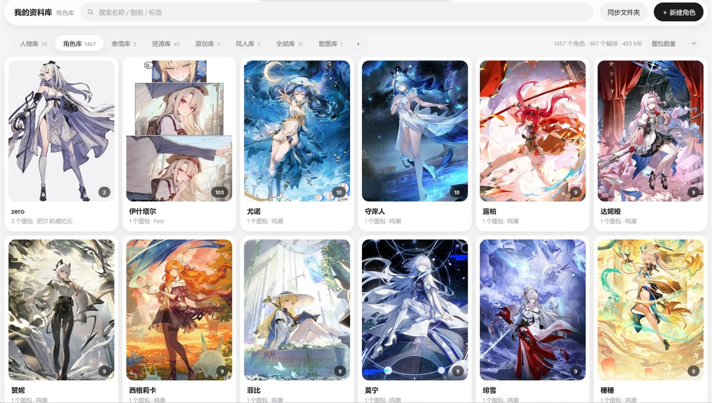
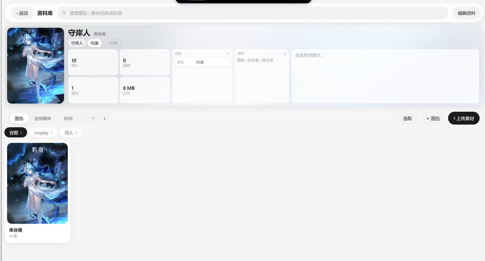

# 자료실 · Character Library

[English](README.en.md) · [日本語](README.ja.md) · **한국어** · [繁體中文](README.zh-TW.md) · [Русский](README.ru.md) · [Français](README.fr.md) · [简体中文](README.md)

> 내 컴퓨터에서만 돌아가는 애니메이션 · 코스프레 자료 라이브러리입니다.
> 이미지와 영상은 **라이브러리 → 항목 → 팩 → 이미지 | 영상** 4단계로 정리되고,
> 디스크의 폴더 구조가 화면의 계층과 그대로 대응합니다. 메이슨리 보기, 태그,
> 만화 뷰어, 압축 파일 자동 풀기, 증분 디스크 동기화까지 모두 들어 있습니다.
> **데이터는 절대 외부로 나가지 않습니다. 클라우드도, 업로드도, 텔레메트리도 없습니다.**

**스캐너가 아닙니다.** 자료는 라이브러리로 **복사**되며 언제든 분류하고 고칠 수 있습니다.
원본 폴더는 건드리지 않습니다.

> 화면과 코드 주석은 **중국어 간체 전용**입니다(앱 자체는 다국어를 지원하지 않습니다).
> **이 문서는 요약본입니다.** 모든 화면 설명 · API 목록 · 튜닝 기록 · 알려진 문제 · 버전 기록이 담긴
> 상세 버전은 **[简体中文](README.md)** 와 **[English](README.en.md)** 두 개뿐입니다.

## 스크린샷

**라이브러리 목록** — 카드 하나가 항목 하나이고, 오른쪽 아래 배지가 팩 개수입니다.
상단 바에서 라이브러리를 전환하고, 검색창은 라이브러리 전체를 검색합니다.



**항목 상세** — 왼쪽에 커버와 집계, 가운데에 출처 · 별칭, 아래에 팩 목록이 있습니다.
"전체 미디어"로 바꾸면 이 항목의 모든 파일을 볼 수 있습니다.



## 무엇을 할 수 있나

- **다섯 가지 라이브러리** — 인물(코스플레이어 + 계정 칸), 캐릭터(작품별 분류), 리소스(작품당 카드 한 장),
  이모지 / 낱개 이미지(플랫), 소설(TXT 뷰어 + 삽화 + 만화 주머니). 그 외에 분류 전 파일을 모아 두는
  "전체 라이브러리"가 있습니다.
- **자료를 넣는 네 가지 방법**
  - 드래그 앤 드롭: 한 번에 400개, 파일당 4 GB까지. 진행률과 파일별 실패 사유를 보여 줍니다
  - **압축 파일을 그대로 떨어뜨리기**: zip / rar / 7z / tar.gz를 자동으로 풀고 이미지와 영상만 넣습니다.
    zip은 직접 파싱하므로(GBK 파일명도 깨지지 않음) **암호가 걸린 압축 파일은 비밀번호를 묻고 기억합니다**
  - 폴더에서 일괄 가져오기: sha256으로 중복을 걸러 내고 파일명의 날짜로 팩을 만듭니다.
    `--move`는 라이브러리 쪽 사본을 검증한 뒤에만 원본을 지웁니다
  - **데스크톱 셸로 끌어다 놓기**: 브라우저는 바이트만 받지만 셸은 실제 경로를 알기 때문에,
    **가져오기에 성공하면 원본 파일을 삭제**할 수 있습니다
- **보기** — 메이슨리를 나눠 그려 수만 장도 끊기지 않습니다. 정렬 기준 네 가지, 가로로 긴 이미지는
  두 칸 차지, 썸네일은 가져올 때 생성
- **태그** — "캐릭터-의상" 같은 팩 이름은 자동으로 태그 두 개로 나뉘고, 항목 이름도 태그가 됩니다.
  태그를 누르면 태그 페이지로 이동합니다
- **검색** — 상단 검색창이 라이브러리 목록 · 항목 · 리소스 목록 · 리소스 상세를 모두 검색합니다.
  서버가 태그도 찾기 때문에 작품명을 치면 태그만 가진 항목도 나옵니다
- **만화 뷰어** — 연속 스크롤 / 한 페이지 / 두 페이지, 오른쪽에서 왼쪽, 높이 맞춤 / 너비 맞춤,
  전체 화면, 휠로 페이지 넘기기, 좁은 창에서는 사이드 레일 자동 축소
- **일괄 처리와 키보드** — Shift 범위 선택, Ctrl 추가 · 해제, `Ctrl+A` 전체 선택, Delete, Esc.
  거의 모든 요소에 오른쪽 클릭 메뉴가 있습니다
- **디스크 동기화** — 이름 변경 · 이동 · 삭제 때마다 데이터 변경과 **같은 트랜잭션**으로 작업 로그를
  남깁니다. 동기화 버튼은 그 차이만 처리하고 라이브러리 전체를 훑지 않습니다.
  또한 자기가 놓지 않은 파일은 절대 지우지 않습니다
- **백업** — `VACUUM INTO` + 표본 해시 검증 + MANIFEST, 최근 5개 보관

## 기술 구성

| 부분 | |
|---|---|
| 프런트엔드 | 순수 ES Modules, **빌드 과정 없음**(webpack / vite / 번들러 없음), CSS 변수와 직접 만든 컴포넌트 |
| 백엔드 | Node 22 · Express 5 · better-sqlite3 · sharp(libvips) · ffmpeg |
| 데스크톱 셸 | Rust · tao + wry(WebView2) — **689 KB 단일 exe**, CRT 정적 링크, 함께 배포할 DLL 없음 |
| 저장 방식 | SQLite 인덱스 + 디스크의 원본. 경로는 데이터 루트 기준 **상대 경로**라 드라이브를 옮겨도 데이터를 고칠 필요가 없음 |

## 빠른 시작

**Node.js 20 이상**이 필요합니다(개발 · 검증은 22). 첫 실행 때 데이터베이스가 자동으로 만들어집니다.

```bash
cd server && npm install && cd ..
start.bat          # 서버를 띄우고 http://127.0.0.1:7788 을 엽니다
```

데이터 폴더 기본값은 `E:\CharacterLibrary`입니다. 다른 곳에 두려면 환경 변수로 지정하세요.

```bat
set CL_DATA_DIR=D:\MyLibrary
set CL_CACHE_DIR=D:\my-cache
start.bat
```

브라우저 대신 창으로 쓰고 싶다면 데스크톱 셸을 빌드합니다
(Windows에서 Rust 툴체인과 VS2022 Build Tools 필요).

```bash
node desktop/build.mjs      # 프로젝트 루트에 资料库.exe 생성
```

exe는 프로젝트 루트에 두세요(`server/src/index.js`를 위로 올라가며 찾습니다).
바탕 화면에 두고 싶으면 바로 가기를 만드세요.

## 데이터 위치

| 위치 | 기본 경로 | 내용 |
|---|---|---|
| 프로그램 | 저장소 폴더 | 코드, `web/`, `server/`, exe, `.cache`(썸네일 — 지워도 다시 만들어집니다) |
| 데이터 | `E:\CharacterLibrary`(`CL_DATA_DIR`) | 원본 미디어 + 인덱스 `.catalog\library.db` |
| 백업 | `E:\CharacterLibrary-Backup`(`CL_BACKUP_DIR`) | 실행할 때마다 타임스탬프 폴더, 최근 5개 보관 |

데이터는 하드디스크(용량 · 순차 읽기), 캐시는 SSD(무작위 읽기가 많음)에 두는 것을 권합니다.

## 알려진 제한

- 파일당 4 GB, 한 번에 400개까지(압축 파일도 동일)
- rar / 7z 압축 풀기에는 7-Zip 또는 WinRAR이 필요합니다(Windows 기본 `tar.exe`도 가능). zip은 추가 도구 불필요
- `mkv` / `avi`는 브라우저에서 재생되지 않을 수 있습니다
- 같은 항목 안에서 팩 사이를 옮기면 데이터베이스만 바뀌고, 파일은 다음 동기화 때 이동합니다
- 데스크톱 셸은 Windows 전용(WebView2)입니다. 웹 앱 자체는 Node가 도는 환경이면 어디서든 실행됩니다
- **화면은 중국어 전용입니다.** i18n 계층이 없고, 넣을 계획도 없습니다.

## 라이선스

개인 프로젝트로 **오픈소스 라이선스를 선언하지 않았습니다**(All rights reserved).
구현을 읽고 이슈를 남길 수 있도록 공개한 것일 뿐, 상업적 사용이나 재배포를 허락하는 것은 아닙니다.
